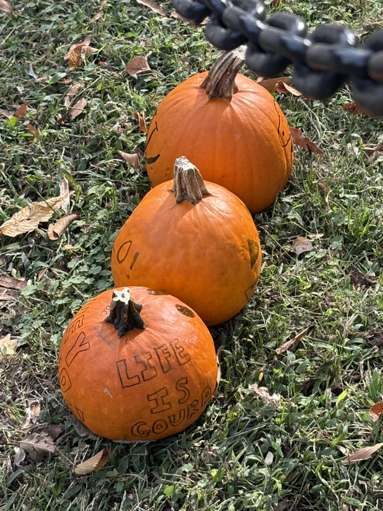
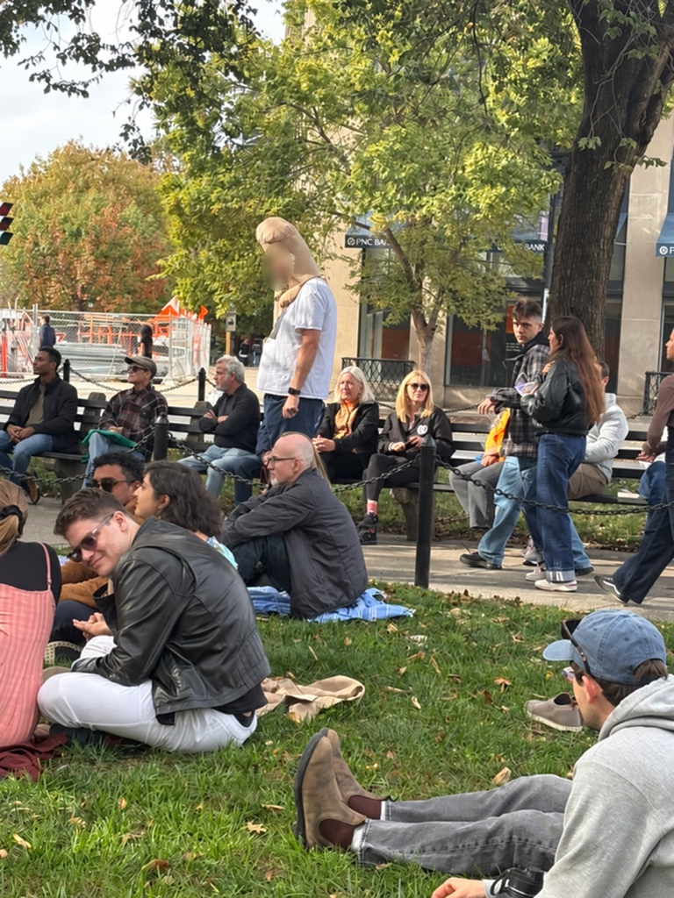
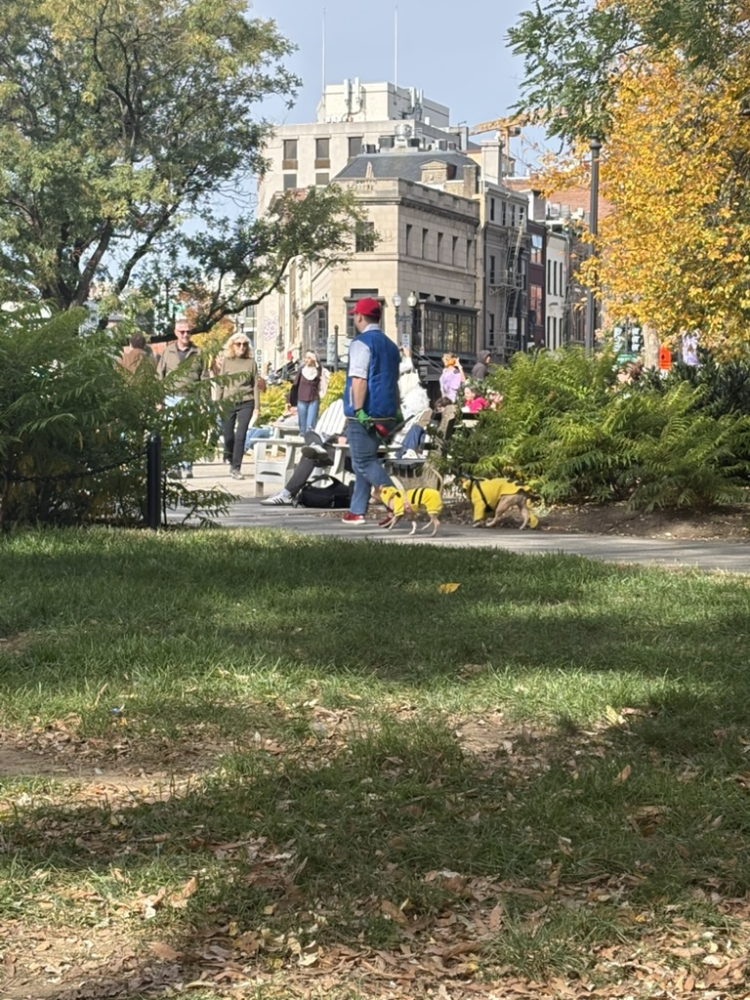
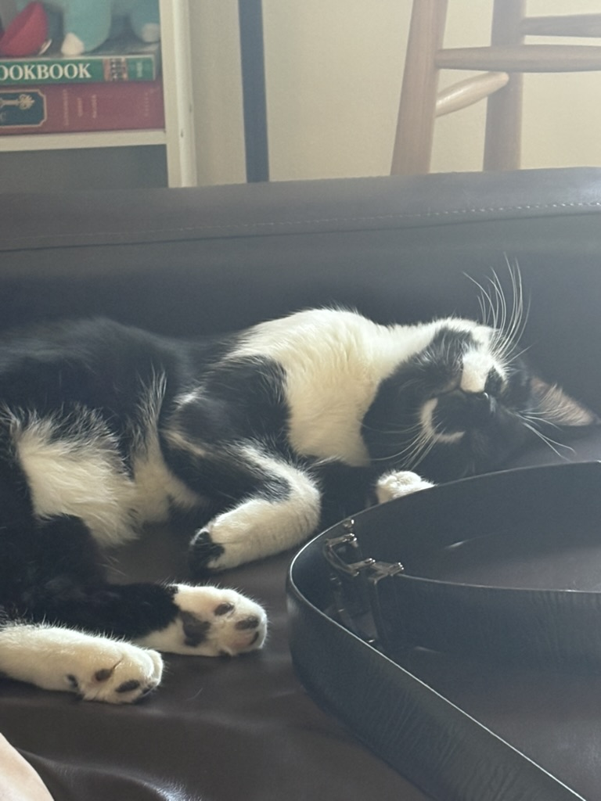

I experienced DC on halloween for the first time. In my previous years in US, I stayed inside my home in College Park. My stupid little walk for my stupid little mental health took me a little too far this time - to Dupont Circle.

The main attraction were the costumes themselves: I saw people dressed as forrest gump and the following reporters, ash ketchum with pikachu, starbucks barista, women of bridgerton, luigi (mangione) and luigi (from mario), breathalyzer (very scary), waldo (I found two waldos on two days; wasnt the whole point to be hard to find?) and the best of all: a literal dick. The best part about these costumes was that it didnt feel like people dressed just for the sake of it: it seemed that they were just doing whatever they do everyday: running, jogging, walking dogs.

  
  

For some side quests, I visited Kramers bookstore for the first time. The book that I found interesting was [The Lucky Ride](https://www.goodreads.com/en/book/show/223338921-the-lucky-ride); it was selling for $24, so I resorted to my trustee good-old AbeBooks. Sorry Kramers!

I also picked up Cardamom Chai and Almond Croissant from [Afghan Chai](https://afghanchai.com/pages/about-us-our-qissa). The owners (amazing people!) assumed that I have been there before (assuming because of my too-indian appearance and accent) and let me pick on my own; I played along as well. If you go there for the first time, they would let you taste both of their teas: Cardamom and Oatmilk, then give you an option to get either or half/half, hot or cold and optionally make it dirty i.e. add espresso to it. I love oatmilk chai as well; going to be my pick for the next time.

Came home to a sleeping [Pongo](https://www.petfinder.com/cat/pongo-d1f12d3c-a089-4245-a404-600a11891eac/md/hyattsville/a-cats-life-rescue-md492/details/): dude didn't budge on my arrival. Hope you learns to love me back sometime (sigh).