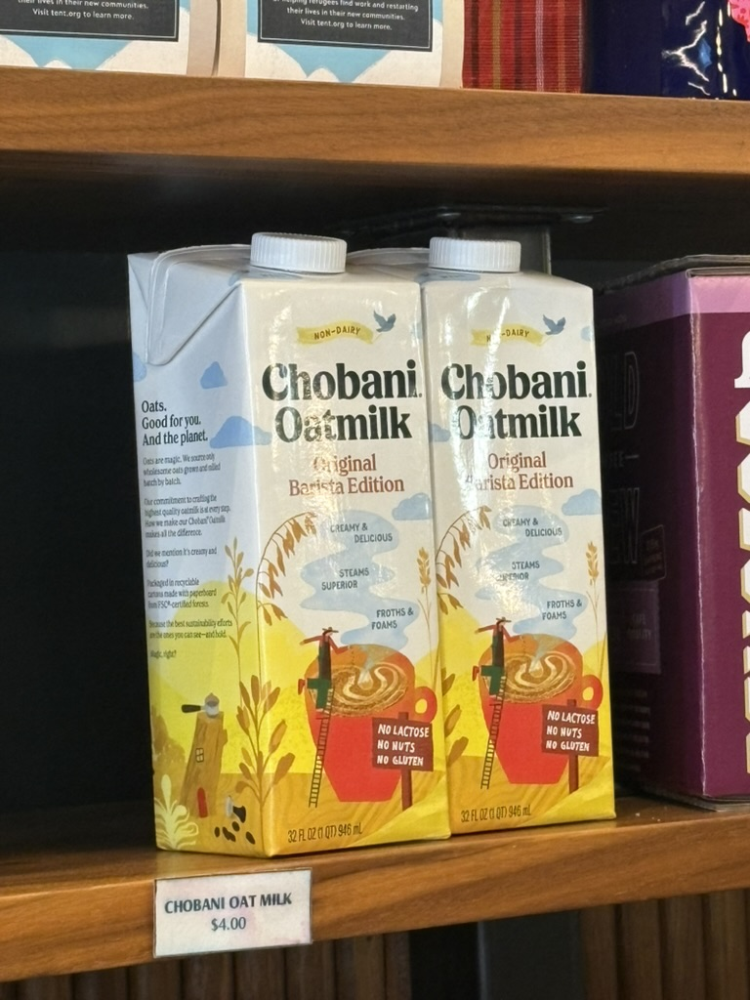

My heart is heavy today, remembering Chobani Extra Creamy Oatmilk, which, in an unexpected turn of events, got discontinued, along with its inferior brothers. No walmart (except Fairfax one, cant go, no car) no costco would have it on their shelves anymore. Hold tight to your remaining stock, if you still have it. For me, it was a symbol of hope for my bleak work mornings (i.e. every morning).

<figure style="width: 400px; max-width: 100%; margin: 1.5rem auto; text-align: center;">
  
  <figcaption style="margin-top: 0.5rem; font-size: 0.875em; font-style: italic;">Last public spotting of a family member in Chinatown, DC</figcaption>
</figure>

My gut is heavy too, with the mid-ass planet oat oatmilk I had to drink. 

