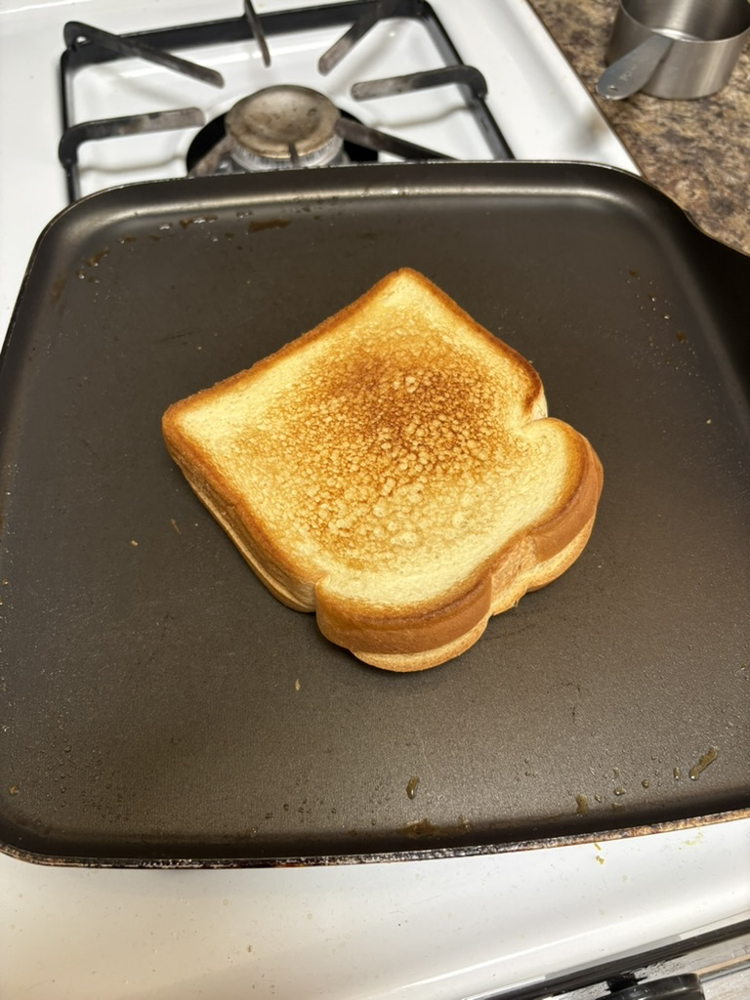

I have a blood test tomorrow. Even though I am a big man now (i drink protein shake everyday), I still feel a little bit of terror thinking about needles.

This fear though, represents my privilege; a privilege that I dont have to deal with needles enough to not fear them. I feel grateful for this fear.

<!-- This also serves as an irrefutable evidence that I dont do drugs. QED -->

<figure style="width: 400px; max-width: 100%; margin: 1.5rem auto; text-align: center;">
  
  <figcaption style="margin-top: 0.5rem; font-size: 0.875em; font-style: italic;">I cooked (if you can call making grilled cheese cooking) after more than a month. It tasted so good that I took one more picture of the half eaten sandwich, but you probably dont want to see that.</figcaption>
</figure>
