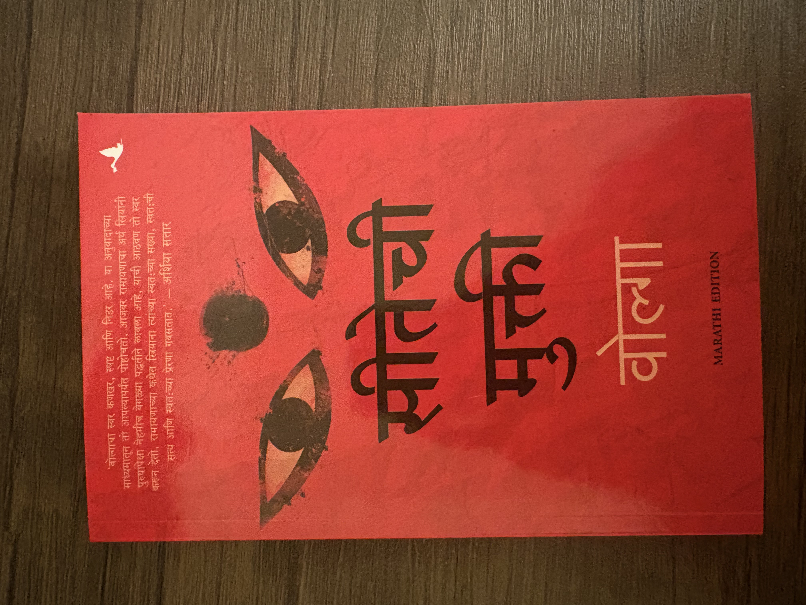

Ramayan is one of the most important epics of Indian culture. It tells the story of Ram, who goes into exile in the forest with Sita and Lakshman. There, Raavan abducts Sita, and Ram eventually kills him.

My complaint about Ramayan is how plainly it’s taught, especially to kids. When I think back to my childhood, I remember being told what happened, with little room to ask why. One might argue that this is a way to spare kids the more uncomfortable parts of the story. Let’s assume we do need to leave some of those parts out (although I don’t agree). When we teach a story about gods without nuance, emotion, or discussion, kids can take it as a model for how to behave. That’s troubling when some of the characters’ actions are hard to justify today. Take the familiar _agni-pariksha_ (test of fire). Here’s how it sounds as a sequence of events.

> Sita returns from Raavan’s captivity. Ram demands that she prove her chastity by walking through fire. Sita agrees and passes the test.

What might kids take away from this? That it’s okay for men to doubt their wives? That women are guilty until proven otherwise?

_Vimukta_, or _The Liberation of Sita_, by Volga, revisits these events from a feminist perspective. It adds imagined conversations and, more importantly, gives us a sense of the characters’ hesitation, confusion, and pain.

<figure style="width: 400px; max-width: 100%; margin: 1.5rem auto; text-align: center;">
  
  <figcaption style="margin-top: 0.5rem; font-size: 0.875em; font-style: italic;">I have been learning Marathi and my over-confident ass thought it would be great to read my next book in Marathi. I could not read a single page. Ended up reading the english version on kindle.</figcaption>
</figure>

The book tells four stories from Sita’s perspective and a final one from Ram’s. In each of the first four, Sita meets a woman who has suffered an injustice. Each woman’s story shapes Sita’s journey to liberation.

The book makes you uneasy, and some of the author’s reinterpretations of Valmiki Ramayan make it even more uncomfortable. I think that’s for the better. I blame the education system for much of that unease. When we’re taught to learn stories like Ramayan by rote and discouraged from asking questions, blind belief becomes a habit. Even asking why Ram demanded the test can feel like crossing a line.

You might end up empathizing with the protagonists, or you might be angry at how the book reinterprets the story. Either way, the author makes the injustices in Ramayan harder to gloss over.
