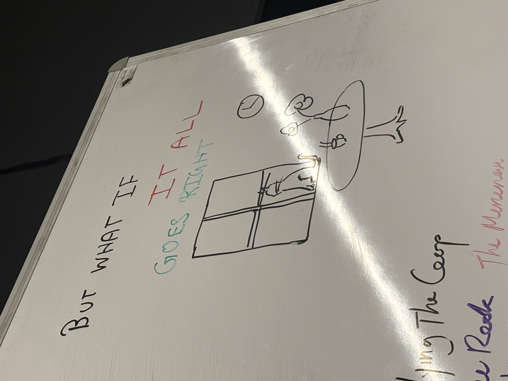

## Introduction

Suppose you pick two messages and I encrypt one of them. I show you the ciphertext. Can you tell which message I chose?

You already know both possible messages, so asking whether you can recover the message would be a rather weird way to measure security. The question is whether the ciphertext helps you tell the two possibilities apart.

In [Part 1](/blog/security1/), the reduction had a short job. It handed the attacker a Diffie–Hellman transcript and returned whatever shared secret the attacker recovered. Recovering the secret was already the answer to the computational Diffie–Hellman problem.

Here the attacker gives us a guess about which message was encrypted. How do we turn that guess into anything about Diffie–Hellman? The new idea is to run the same experiment with two kinds of ciphertexts. One uses the real Diffie–Hellman value to mask the message. The other uses a random mask, which makes the attacker's guess no better than a coin flip. If the attacker does better with the real ciphertext, that difference gives us a way to tell a real Diffie–Hellman value from a random one.

We will work through that argument for ElGamal, an encryption scheme built from Diffie–Hellman.

## Public-Key Encryption

Suppose Alice wants to send Bob a private message. In **public-key encryption**, Bob generates two keys. He publishes one, called the **public key**, and keeps the other, called the **secret key**, to himself. Alice uses the public key to turn her message into a ciphertext. Bob uses his secret key to turn the ciphertext back into the message.

Anyone who has Bob's public key can send him an encrypted message, including someone who has never talked to Bob before. An eavesdropper can have the very same public key and see the ciphertext. What should it mean for Alice's message to stay private in that situation?

<figure style="width: 400px; max-width: 100%; margin: 1.5rem auto; text-align: center;">
  
  <figcaption style="margin-top: 0.5rem; font-size: 0.875em; font-style: italic;">A grafitti about hope by anonymous lab member. Hope all your security proofs go through.</figcaption>
</figure>

## The Security Game

A **security game** is an experiment between an attacker and a challenger. The challenger runs the experiment and keeps track of the secrets. The rules specify what the attacker sees, what it can do, and what counts as winning.

Here is the game for **indistinguishability under chosen-plaintext attack**, or **IND-CPA**, for public-key encryption:

1. The challenger generates a key pair and gives the public key to the attacker.
2. The attacker chooses two valid messages $m_0$ and $m_1$ of the same length and sends them to the challenger.
3. The challenger samples a uniform bit $b \in \{0,1\}$ and sends back a fresh encryption of $m_b$.
4. The attacker outputs a guess $\widehat b$. It wins if $\widehat b=b$.

The attacker gets to choose the messages after seeing the public key. And since it has that key, it can encrypt any other messages itself, before or after it sees the challenge ciphertext.

Even a random guess wins half the time. We will measure the attacker's **advantage** by how far its win probability is from that baseline:

$$
\operatorname{Adv}_{\mathrm{IND\text{-}CPA}}(\mathcal A)
= \left|\Pr[\widehat b=b]-\frac12\right|.
$$

The probability is over key generation, the choice of $b$, the randomness used to encrypt, and the attacker's own randomness. The scheme is IND-CPA secure if this advantage is negligible for every efficient attacker.

Why does encryption need fresh randomness? Suppose encryption were deterministic. The attacker could choose two distinct messages, encrypt both with the public key, and compare the results with the challenge ciphertext. Correctness requires the two ciphertexts to be different, so the attacker would win every time.

## ElGamal Encryption

We use the same setting as in Part 1. Let $G=\langle g\rangle$ be a cyclic group of prime order $q$. For this version of ElGamal, messages are elements of $G$.

1. **Key generation.** Bob samples $x$ uniformly from $\mathbb Z_q$ and publishes $X=g^x$. He keeps $x$ secret.
2. **Encryption.** To encrypt $m$, Alice samples a fresh uniform $r\in\mathbb Z_q$ and sends $(Y,C)=(g^r,mX^r)$.
3. **Decryption.** Bob computes $Y^x$ and divides it out of $C$, recovering $m$.

The last step works because $Y^x=(g^r)^x=(g^x)^r=X^r$. This is the same equality that gave us correctness for Diffie–Hellman. Here the shared value masks the message, and Alice's fresh exponent gives her a fresh mask for each encryption.

## The Assumption

The **decisional Diffie–Hellman (DDH) assumption** concerns two ways of sampling a tuple:

$$
(g,g^x,g^r,g^{xr})
\qquad\text{and}\qquad
(g,g^x,g^r,g^z),
$$

where $x,r,z$ are independently uniform in $\mathbb Z_q$. The last element is either the shared Diffie–Hellman value or an independent uniform group element. We measure a distinguisher's advantage by the absolute difference between its probabilities of outputting $1$ on the two distributions. The assumption says this difference is negligible for every efficient distinguisher.

## The Reduction

Suppose we have an efficient attacker $\mathcal A$ that plays the IND-CPA game for ElGamal. We build a DDH distinguisher $\mathcal R$ using that attacker.

1. Receive a DDH challenge $(g,U,V,T)$ and give $\mathcal A$ the public key $X=U$.
2. Receive the two messages $m_0,m_1$. Sample a uniform bit $b$ and give $\mathcal A$ the ciphertext $(V,m_bT)$.
3. Receive the guess $\widehat b$. Output $1$ if $\widehat b=b$ and $0$ otherwise.

Notice that $\mathcal R$ can do all this without knowing the exponents behind $U$ and $V$. The challenge gives it the three group elements it needs. What changes between the two cases is what $T$ represents.

### When $T$ is the shared value

Write $U=g^x$ and $V=g^r$. If $T=g^{xr}$, the ciphertext is

$$
(V,m_bT)=(g^r,m_b(g^x)^r).
$$

This is exactly an honest ElGamal encryption of $m_b$. The exponents have the right distribution, so $\mathcal A$ sees the real IND-CPA game. The probability that $\mathcal R$ outputs $1$ is the attacker's win probability in that game.

### When $T$ is uniform

Now $T$ is an independent uniform element of $G$. Fix the public key, $V$, and the two messages the attacker chose. For any $c\in G$, there is exactly one value of $T$ for which $m_bT=c$, namely $m_b^{-1}c$. Thus $m_bT$ is uniform for either value of $b$.

The attacker sees the same distribution of ciphertexts whichever message was selected. Its guess matches $b$ with probability exactly $1/2$, so $\mathcal R$ outputs $1$ with probability $1/2$.

### Putting the two cases together

$$
\begin{aligned}
\operatorname{Adv}_{\mathrm{DDH}}(\mathcal R)
&= \left|\Pr_{\mathrm{DH}}[\mathcal R\text{ outputs }1]
       -\Pr_{\mathrm{uniform}}[\mathcal R\text{ outputs }1]\right| \\
&= \left|\Pr[\widehat b=b\text{ in the real game}]-\frac12\right| \\
&= \operatorname{Adv}_{\mathrm{IND\text{-}CPA}}(\mathcal A).
\end{aligned}
$$

The reduction runs the attacker once and does a small amount of extra work, so it is efficient whenever the attacker is. If the attacker had non-negligible advantage, the reduction would have the same advantage against DDH. Therefore, ElGamal is IND-CPA secure under the DDH assumption.

## What Changed Between the Games?

Replacing the mask was a **game hop**. To justify the hop, we asked what would happen if the attacker's win probability changed by a noticeable amount. The reduction could use that change to distinguish the two DDH distributions, just by checking whether the attacker won. In a longer proof, we might make several hops and bound how much the win probability can change at each step.

_Note:_ AI used for polishing text and finding bugs.
